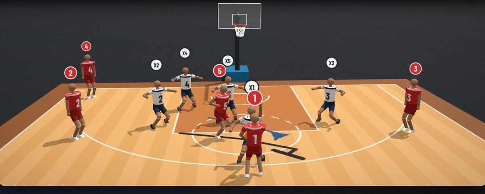
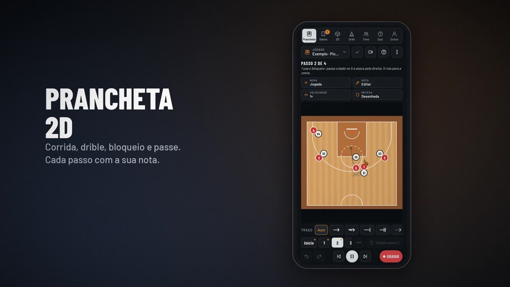

# Tatik

Prancheta de basquete em 2D e 3D para técnicos e atletas.

**Abrir o Tatik: https://basketball-training-coach.netlify.app**

- Monte a jogada passo a passo na prancheta 2D: corrida, drible, bloqueio e passe.
- A defesa se move sozinha, individual ou por zona.
- Assista em 3D de qualquer ângulo ou na visão do jogador.
- Drills em 3D, link da jogada para o time, quem assistiu e quiz para os atletas.
- Exporta vídeo pronto para o celular e instala como app no iPhone e no Android.

Feito por [Rafael Kluge](https://rafaklugee.github.io).
